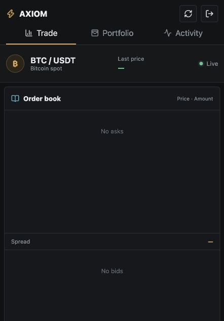
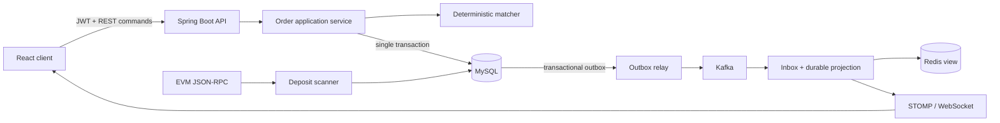

# Exchange Java

[](https://github.com/ShaoyeLi/exchange-java/actions/workflows/ci.yml)
[](https://openjdk.org/projects/jdk/21/)
[](https://spring.io/projects/spring-boot)
[](LICENSE)

A runnable digital-asset spot exchange reference implementation built with Java 21 and Spring Boot. It combines deterministic price-time-priority matching with transactional fund reservation, double-entry-style ledger evidence, reliable event delivery, market-data projections, and EVM deposit indexing.

> This repository is an engineering reference implementation, not a production custody system. See [System boundaries](#system-boundaries) before reusing it.

[中文说明](README.zh-CN.md)



## Architecture



MySQL is authoritative for orders, wallets, trades, ledger entries, deposits, withdrawals, idempotency records, and consumer projections. Kafka transports committed events; Redis and WebSocket provide rebuildable views and live delivery.

Read the [architecture overview](docs/architecture.md) for the complete request and event flow.

## Implemented capabilities

- **Matching:** LIMIT and MARKET orders, GTC/IOC/FOK time in force, price-time priority, partial fills, maker-price execution, and self-trade prevention.
- **Funds and settlement:** fixed-point arithmetic, available/locked balances, deterministic wallet locking, fee settlement, price-improvement release, append-only ledger postings, and rollback-safe updates.
- **Command safety:** database-backed idempotency keys, request hashing, optimistic version checks, and bounded deadlock retries.
- **Reliable events:** transactional outbox, broker acknowledgements, retry/backoff, dead-letter state, Kafka delivery, transactional inbox deduplication, and durable market projections.
- **Live market data:** MySQL-backed snapshots, Redis rebuildable views, market sequence numbers, and STOMP/WebSocket deltas.
- **EVM deposits:** Web3j JSON-RPC access, ERC-20 `Transfer` decoding, persisted scan cursors, confirmation thresholds, duplicate protection, and shallow-reorganization handling.
- **Application surface:** JWT authentication, role-based authorization, order/account/withdrawal/operations APIs, React trading console, health probes, Prometheus metrics, and trace correlation.

## Core invariants

1. Wallet balances never become negative.
2. Every committed balance change has append-only ledger evidence in the same transaction.
3. Replaying the same command or chain event cannot create a second financial effect.
4. Terminal orders cannot reopen, and `filled + remaining = original quantity`.
5. Matching is deterministic for the same market state and command sequence.
6. Chain confirmation and internal crediting are separate state transitions.

## Technology

- Java 21, Spring Boot 3.5, Spring JDBC, Spring Security, Micrometer
- MySQL 8.4, Flyway, Kafka, Redis, Testcontainers
- Web3j, JWT, STOMP/WebSocket
- React 19, TypeScript, Vite
- Docker Compose and GitHub Actions

## Run locally

Prerequisites: JDK 21, Node.js 24, and Docker Desktop.

```bash
docker compose up -d mysql kafka redis

EXCHANGE_REDIS_PORT=6380 \
EXCHANGE_MESSAGING_ENABLED=true \
EXCHANGE_DEMO_ENABLED=true \
SPRING_PROFILES_ACTIVE=observability \
./mvnw spring-boot:run
```

In another terminal:

```bash
cd frontend
npm ci
npm run dev
```

Open <http://localhost:5173> and use one of the local-only demo accounts:

- Trader: `trader@example.com` / `Trader123!`
- Operator: `admin@example.com` / `Admin123!`

To run the complete containerized stack:

```bash
cp .env.example .env
docker compose --profile app up --build
```

Then open <http://localhost:4173>.

## Verification

```bash
./scripts/verify.sh
node scripts/smoke-test.mjs
```

The verification script runs Java unit, architecture, and Testcontainers integration tests, followed by a clean frontend build. The smoke test expects the application stack to be running and checks login, idempotent order submission, cancellation, and fund release.

See [verification.md](docs/verification.md) for the covered failure scenarios and evidence boundaries.

## Repository layout

```text
src/main/java/com/ethan/exchange/
  matching/       Matching domain and in-memory transaction-local order book
  order/          Transactional order and settlement orchestration
  infrastructure/ JDBC stores and authoritative persistence
  messaging/      Outbox, Kafka, inbox, projections, Redis, and WebSocket
  chain/          EVM block scanning, confirmations, and reorganization handling
  withdrawal/     Withdrawal reservation and cancellation workflow
  security/       JWT, password hashing, roles, and authenticated principal
  api/            Trading, account, market-data, withdrawal, and operations APIs
  observability/  Request correlation, metrics, traces, and backlog gauges
frontend/         React and TypeScript console
```

## Design documents

- [Architecture and data ownership](docs/architecture.md)
- [Transactions, reservations, and ledger](docs/transactions-and-ledger.md)
- [Reliable events and live market data](docs/reliable-events.md)
- [EVM deposit indexing](docs/evm-deposit-indexing.md)
- [Application and security model](docs/application-and-security.md)

## System boundaries

The project does not implement private-key custody, withdrawal signing or broadcasting, MPC/HSM integration, AML/KYT workflows, replicated matching consensus, multi-region failover, or a production SLA. EVM indexing is tested through HTTP JSON-RPC fixtures and database state-machine tests; it has not been certified against a production node or real funds.

Kafka delivery uses at-least-once semantics with stable event IDs and inbox deduplication. Redis and WebSocket are not financial sources of truth.

## License

Released under the [MIT License](LICENSE).
